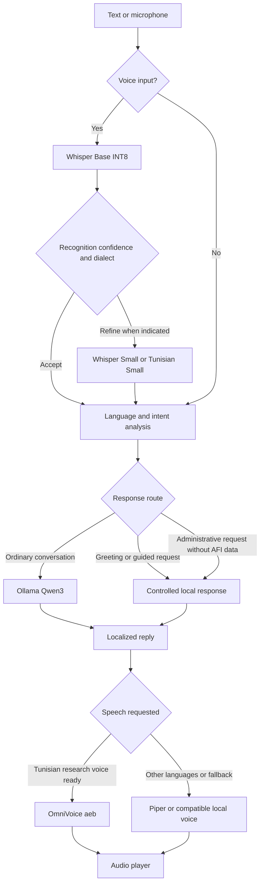

# Dalila Language Lab

**Multilingual text and voice assistant for the AFI hackathon — v0.8.1**

Dalila is a standalone research prototype for understanding Tunisian Arabic (Derja), Arabizi, Modern Standard Arabic, French, English, Algerian Arabic, Libyan Arabic, German and Turkish. It accepts typed messages and microphone recordings, automatically chooses local models and generates spoken replies.

**Start here if you are a teammate.** You do not need to choose models in the interface, obtain API keys, download a ZIP, or modify any code. The recommended path is Windows + PowerShell + Ollama. This module does not connect to the verified AFI knowledge base yet; it must not be presented as a factual AFI assistant.

[](https://github.com/mohamedyassineabdi/Dalila_Language/actions/workflows/tests.yml)

## 1. Quick start — Windows 10/11

### Prerequisites (install once)

| Software | Where to obtain it |
|---|---|
| Git | https://git-scm.com/download/win |
| Python **3.11**, 64-bit, including the Python launcher | https://www.python.org/downloads/ |
| Ollama for Windows | https://ollama.com/download/windows |

Use a normal PowerShell terminal. Check installation with:

```powershell
git --version
py -3.11 --version
ollama --version
```

If a command is missing, install the relevant software and reopen PowerShell. Ollama is needed for open-ended conversational generation; the app can run with limited controlled replies without it. A browser with microphone permission is needed for voice input.

**Hardware planning:** a 64-bit x86 PC, 16 GB RAM and at least 20 GB free disk space are recommended starting points, not guaranteed minimums. The full experimental Tunisian neural voice and simultaneous LLM/ASR can need more RAM and disk; 32 GB RAM is preferable for experimentation. CPU mode works without a GPU. Internet is needed for installation and initial public model downloads. No paid account is needed for the local workflow.

### Clone and launch

The repository is private. The owner must grant your GitHub account access first. Sign in using Git Credential Manager when prompted; do not share credentials or tokens.

```powershell
git clone https://github.com/mohamedyassineabdi/Dalila_Language.git
cd Dalila_Language
powershell -ExecutionPolicy Bypass -File .\run.ps1
```

The launcher creates the Python 3.11 virtual environment if absent, installs core dependencies and runs initial tests. It checks/starts Ollama if installed, prepares Qwen3 4B if needed, installs the Piper and offline fallback speech engines, and starts the local web server. Model weights download during initial preparation or first use. Downloads may involve several GB. The terminal must remain open.

Open **http://127.0.0.1:7860** in your browser. Refresh with Ctrl+F5 after updates. Check the version and model readiness in the header.

### Enable the experimental Tunisian neural voice

For **noncommercial research only**, after reviewing the [OmniVoice model terms](https://huggingface.co/k2-fsa/OmniVoice), stop the server with Ctrl+C and launch:

```powershell
powershell -ExecutionPolicy Bypass -File .\run.ps1 -TunisianResearchVoice
```

This creates an isolated `.venv-tunisian` environment, installs the research runtime and prepares the pinned model (~3.27 GB for model files, plus runtime dependencies). The local opt-in marker persists across launches. It does not clone anyone's voice and does not transmit user speech/text to a hosted TTS API.

The interface shows `Tunisian voice: preparing`, then `ready` if initialization succeeds. Wait for readiness before evaluating the specialized voice. If unavailable or timed out, the app retains the generic Arabic neural/offline fallback and reports a diagnostic reason. The first uncached utterance may still be slow.

For ordinary subsequent launches:

```powershell
powershell -ExecutionPolicy Bypass -File .\run.ps1
```

Disable the research model and return to lighter speech generation:

```powershell
powershell -ExecutionPolicy Bypass -File .\run.ps1 -DisableTunisianResearchVoice
```

This removes the opt-in marker, not the downloaded model files.

## 2. How to use Dalila

1. Type a message and press **Send** (or Enter). Shift+Enter inserts a newline.
2. For voice input, click the microphone, allow access, speak naturally, then click again to stop. Dalila transcribes and submits automatically. A voice reply is attempted automatically.
3. For a typed message, click **Read reply** to hear the response. Use the player controls if autoplay is blocked.
4. Use **New chat** to clear the conversation. Advanced / research tools contains optional language/model overrides, audio upload and technical diagnostics. Leave these on automatic for ordinary use.

Try these inputs:

| Language | Example |
|---|---|
| Tunisian Arabic | عسلامة! لاباس؟ |
| Tunisian Arabizi | ahla bik |
| Tunisian project request | نحب نحل مشروع صغير، تنجم تعاوني؟ |
| Mixed Tunisian/French | تنجم تبعثلي le dossier par email؟ |
| French | Bonjour, comment allez-vous ? |
| English | Hello, can you understand me? |
| Standard Arabic | مرحباً، هل تفهم العربية؟ |
| Algerian Arabic | واش راك؟ تقدر تعاونّي؟ |
| Libyan Arabic | شن حالك؟ |
| German | Hallo, wie geht es dir? |
| Turkish | Merhaba, nasılsın? |

These are demo prompts, not guaranteed model outputs. The model can misunderstand dialects and code-switching. The interface displays the detected language, actual response backend and elapsed time. A guided reply or baseline is not LLM generation. Administrative questions receive cautious clarifications because AFI retrieval is not connected.

## 3. Update after the first installation

Stop the existing server (Ctrl+C). In the original cloned folder on `main`:

```powershell
git pull --ff-only
powershell -ExecutionPolicy Bypass -File .\run.ps1
```

If you previously tested the experimental latency branch, commit or safely stash your own edits first, then `git switch main` and pull. Never force-reset teammates' work. The launcher reuses the existing environments and cached models. Do not delete and reinstall everything for routine updates.

## 4. Architecture and model routing



| Layer | Technology | Purpose |
|---|---|---|
| Web interface | HTML/CSS/JS + browser MediaRecorder | Simple chat, microphone and playback |
| API | FastAPI, Uvicorn | Local HTTP service |
| General speech recognition | Faster-Whisper Base, CPU INT8 | Fast multilingual first pass |
| Recognition escalation | Whisper Small / TheBiggyBang Tunisian Small CT2 | Uncertain or Tunisian input |
| Experimental recognition challengers | whisperX-tunisian, turbo, large-v3, converted Tunisian code-switch checkpoint | Research comparisons, not automatic production defaults |
| Language/intent analysis | Hybrid word/character classifiers and lexical patterns | Dialect proposals, intent, mentions, numbers, negation |
| Conversational LLM | Ollama Qwen3 4B preferred; supported local models discovered | Short contextual replies; 8B optional |
| General neural TTS | Piper | Arabic (Jordanian Kareem), French (Siwis), English (Lessac), German (Thorsten), Turkish (DFKI) |
| Tunisian neural TTS (opt-in) | k2-fsa/OmniVoice, language `aeb` | Dialect-targeted synthetic speech |
| Speech fallback | Packaged eSpeak NG, Windows SAPI, compatible browser voices | Maintain sound coverage when neural TTS unavailable |

The automatic speech-recognition confidence heuristic is experimental and can miss errors. The selected general and specialist models can both run for a single utterance, increasing latency. Qwen3 is configured for short output and kept warm between calls. The Tunisian worker uses four generation steps, a 45-second synthesis timeout and an ephemeral exact-reply audio cache. If the worker times out, restart the app to retry uncached synthesis. Non-Tunisian language routing is unchanged.

### Language codes

`aeb` Tunisian Arabic (including Arabizi), `ar` Modern Standard Arabic, `arq` Algerian Arabic, `ayl` Libyan Arabic, `fr` French, `en` English, `de` German, `tr` Turkish. Automatic recognition does not guarantee correct country-level Arabic dialect identification. Algerian and Libyan spoken output currently falls back to generic Arabic voices.

## 5. Optional settings

No `.env` file is required for normal use. To customize the local setup, copy the example if needed:

```powershell
Copy-Item .env.example .env
```

Do not overwrite an existing configuration. Keep it local. Supported options include:

| Setting | Normal launcher default / usage |
|---|---|
| `OLLAMA_MODEL` | `qwen3:4b`; use `qwen3:8b` if installed and resources permit |
| `DALILA_GENERAL_ASR` | `base` on Windows; set `small` for quality-first comparison |
| `ASR_DEVICE`, `ASR_COMPUTE_TYPE`, `ASR_THREADS` | Launcher sets CPU, int8, 4 threads |
| `ASR_BEAM_SIZE` | Launcher defaults to 1 (greedy decoding) |
| `ASR_REFINE_TUNISIAN` | `low_confidence` or `always` for the Small general path |
| `ASR_OFFLINE` | `1` restricts ASR to available cached/local model files |
| `DALILA_TUNISIAN_STEPS` | 4; 16 is quality-first research and much slower |
| `DALILA_TUNISIAN_TIMEOUT` | 45 s; supported range 15–120 s |
| `DALILA_ALLOW_CLOUD` | 0; cloud semantic classification is disabled by default |

For variables where the launcher sets a default if missing, set them in the current PowerShell session **before** launching (rather than relying on `.env` to override the launcher). For example:

```powershell
$env:DALILA_GENERAL_ASR = 'small'
$env:DALILA_TUNISIAN_STEPS = '16'
$env:DALILA_TUNISIAN_TIMEOUT = '120'
powershell -ExecutionPolicy Bypass -File .\run.ps1
```

This is an optional slow, quality-first experiment, not the recommended live demo. Remove those session variables or open a new terminal to restore defaults. Explicit `gemini` and `groq` semantic adapters exist for authorized experiments, but need your own provider key/model and `DALILA_ALLOW_CLOUD=1`. They are not automatic conversational fallbacks; do not send restricted information to them.

## 6. Troubleshooting

| Symptom | What to do |
|---|---|
| Python launcher not found | Install 64-bit Python 3.11 with the launcher, reopen PowerShell |
| Git clone denied | Confirm the repository owner granted your GitHub account access |
| No local LLM / baseline only | Install/start Ollama; check `ollama list`; run `ollama pull qwen3:4b` if needed; restart Dalila |
| Page does not load | Check terminal for errors; open http://127.0.0.1:7860; stop any old instance using port 7860 |
| Slow first message | Check ASR/model readiness; initial downloads and model loading are expected |
| Mic not working | Allow microphone access on localhost in your browser; use the optional upload field to isolate mic issues |
| Wrong dialect | Try a longer natural sentence; use the manual language selector to diagnose |
| Voice silent | Click Read reply and the audio player's play button; inspect status; confirm voice engine dependencies |
| Tunisian voice unavailable | Confirm opt-in, inspect the header reason and PowerShell output; restart after resolving installation/network errors |
| `SynthesisTimeout` | CPU could not finish within the bound; restart, retain four steps or disable the heavy research voice |
| Arabic voice sounds non-Tunisian | Verify OmniVoice readiness and that playback reports OmniVoice, not Arabic fallback |
| Memory pressure | Close competing workloads; disable the experimental Tunisian model; prefer Qwen3 4B |
| Stale interface after git pull | Stop and restart server; Ctrl+F5 |

For diagnostics, run these with Dalila running in another terminal:

```powershell
Invoke-RestMethod http://127.0.0.1:7860/health
Invoke-RestMethod http://127.0.0.1:7860/capabilities | ConvertTo-Json -Depth 5
ollama list
```

Share the error class or terminal traceback with the team, not API keys, private recordings, or private transcripts. If an existing research environment is broken, stop Dalila and rename only that environment before reinstalling:

```powershell
Rename-Item .venv-tunisian .venv-tunisian-backup
powershell -ExecutionPolicy Bypass -File .\run.ps1 -TunisianResearchVoice
```

Only use this if the folder exists and the backup name is unused. It preserves the old environment and normal chatbot. Cached model downloads are typically stored outside the project by Hugging Face.

## 7. Verification and evaluation

Latest verified release evidence (26 November 2026):

| Check | Result |
|---|---|
| Windows Python 3.11 regression suite | 82 passed |
| Linux Python 3.11 regression suite | 82 passed |
| Actual packaged offline speech | WAV smoke tests for eight language codes |
| Actual Piper neural audio | Five language voices generated on Windows CI |
| Actual OmniVoice audio | Seven Tunisian phrases synthesized on Linux CPU |

See [regression run](https://github.com/mohamedyassineabdi/Dalila_Language/actions/runs/45900749337), [Piper run](https://github.com/mohamedyassineabdi/Dalila_Language/actions/runs/45851892671), [4-step OmniVoice run](https://github.com/mohamedyassineabdi/Dalila_Language/actions/runs/45900749305), [16-step OmniVoice run](https://github.com/mohamedyassineabdi/Dalila_Language/actions/runs/45862449243) and [benchmark summary](reports/RELEASE_0.8.1.md).

The 4-step evaluation generated short 2.98–4.61 s audio samples in 8.902–11.709 s on CI, compared with 45.011–60.643 s at 16 steps. These are synthesis timings, not total end-to-end response latency. CI does not establish your PC's performance, native pronunciation, or real microphone accuracy. The Windows regression suite tests routing; the full OmniVoice neural model evaluation used Linux, not Windows. The four-step voice must still pass native-speaker listening tests.

Run the core suite on your machine:

```powershell
.\.venv\Scripts\python.exe -m pytest -q
```

For optional real Tunisian audio evaluation, once the research environment is installed and its license accepted:

```powershell
$env:DALILA_TUNISIAN_RESEARCH = '1'
$env:DALILA_TUNISIAN_STEPS = '4'
.\.venv-tunisian\Scripts\python.exe tunisian_voice_eval.py
```

Outputs: `outputs/tunisian_voice_eval/` (seven WAVs and a JSON report). Stop the web server before running heavy benchmarks. Use native-speaker pronunciation/naturalness ratings; generated WAV validity alone is not a quality score.

Other research tooling:
- `evaluate.py` and `benchmark.py`: text/ASR experiments. The 224 text examples are synthetic unreviewed drafts (72 development, 152 exploratory evaluation).
- `data/recording_kit.csv`, `data/tts_rating_kit.csv`: consented human evaluation templates; `data/audio_manifest.jsonl` intentionally empty.
- `run_benchmarks.ps1 -AcceptPublicTerms`: optional public corpus ASR comparison after reviewing [model and data terms](reports/MODEL_AND_DATA_REVIEW.md). Defaults to 60 clips. `-IncludeLarge` and `-Cuda` are experimental. Review failures, coverage and overlap with training data before interpreting WER/CER.
- `Kaggle_ASR_Benchmark.ipynb`: optional remote evaluation workflow; not a prerequisite for the chatbot. Do not upload private code/data without authorization.
- `verify_models.py`, `prepare_models.py`, `evaluate_numalia.py`: experimental metadata, checkpoint preparation and classifier review. See [historical research guide](docs/RESEARCH_HISTORY.md) for details and cautions.

## 8. Project structure

```text
Dalila_Language/
├── app.py                       # FastAPI entry point
├── run.ps1                      # Main Windows launcher
├── setup.ps1                    # Initial environment + tests
├── requirements*.txt            # Core and optional dependencies
├── .env.example                 # Configuration template, no secrets
├── static/index.html             # Chat interface
├── dalila/
│   ├── chat.py                  # Conversational routing
│   ├── core.py / semantic.py     # Language and intent analysis
│   ├── llm.py                   # Ollama and optional semantic adapters
│   ├── engines.py               # ASR and TTS routing
│   ├── neural_voice.py          # Piper adapter
│   ├── tunisian_voice.py        # Research worker controller
│   ├── tunisian_worker.py       # Local OmniVoice inference
│   └── tts_worker.py            # Packaged fallback synthesizer
├── data/                        # Draft datasets and evaluation templates
├── tests/                       # Regression and offline audio tests
├── reports/                     # Research results and release evidence
├── docs/                        # Historical research guide
├── legacy/                      # Archived original prototype, not main app
└── .github/workflows/            # CI and neural model evaluations
```

## 9. API and integration

Local interactive OpenAPI: http://127.0.0.1:7860/docs

| Method and endpoint | Purpose |
|---|---|
| GET /health | Service health and knowledge status |
| GET /capabilities | Actual configuration and model readiness |
| POST /chat | Text conversation |
| POST /understand | Structured understanding and intent |
| POST /analyze | Older baseline analysis API |
| POST /transcribe | Multipart audio file transcription |
| POST /voice-chat | Combined ASR and chat (without synthesis) |
| POST /speak | Local audio synthesis, WAV encoded as base64 |
| POST /speak-reference | Separate opt-in reference voice research, consent required |

Example JSON body for `POST /chat`:

```json
{"text":"ahla bik","language":"auto","backend":"auto","history":[],"style":"auto"}
```

The response includes assistant text, speech text, language, actual backend, timing, fallback reason and technical analysis. Preserve original messages and extracted values when integrating the separate AFI data system. No AFI fact should be returned until verified retrieval and grounding are connected.

Linux developers can create a Python 3.11 venv, install `requirements.txt` and optionally `requirements-neural-tts.txt`, then run `python -m uvicorn app:app --host 127.0.0.1 --port 7860`. Set `DALILA_PREPARE_MODELS=1` before launching to prepare models. Local Ollama must be available separately. Linux CI is verified; the full manual Linux setup is not independently end-to-end validated. The Dockerfile supports a basic isolated API, but full Docker deployment, host Ollama networking and optional neural worker setup are not validated. Prefer the Windows launcher for teammate demos.

## 10. Privacy, licenses and limitations

- This is a **research/demo release**, not production-ready. No verified AFI database is connected. Do not expose the development server publicly; it has no production authentication or abuse controls.
- The normal workflow is local inference. Downloads of public weights contact their hosts; no default external inference is configured. Temporary uploaded audio is removed by the API. Exact-reply audio cache is memory-only and cleared on restart. Use authorized recordings for evaluation.
- OmniVoice weights are CC BY-NC (noncommercial research only); do not assume authorization for institutional/production use. Review each model/voice's upstream and weight licenses, including Piper voices and eSpeak NG redistribution terms. Optional SILMA/XTTS reference experiments require separate setup, license review and explicit voice consent; they are not active by default. See [historical guide](docs/RESEARCH_HISTORY.md).
- Never commit `.env`, API keys, virtual environments, model weights, personal audio, or private evaluation transcripts. The repository ignores common local artifacts. No source-code license has been declared; do not assume redistribution rights.
- The current ASR accuracy, native Tunisian naturalness, code-switching accuracy and whole-system latency are still experimental. Use the existing fallbacks during demonstrations if needed.

## 11. Team workflow

Work from the shared `main` branch. Use feature branches and pull requests for changes, and run the regression suite before merging. Share improvements, diagnostic results and reproducible benchmark reports, not secrets or private speech data. The Dalila language module remains independent from the AFI data and Marchés Publics repositories.

**Release status: GO for local team research and hackathon demonstration; NO-GO for unattended production deployment.**
